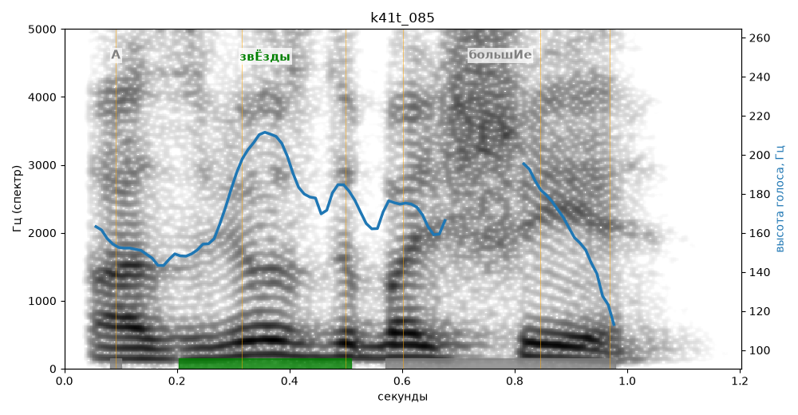

# k41t_085

Эталон: А звёзды большие?
Распознано: А звезды большие.
Слова: все совпали

## Ударения
(где нужно: ruaccent)

| слово | нужно | у голоса | |
|---|---|---|---|
| звёзды | звЁзды | звЁзды | ✓ |
| большие | большИе | большиЕ | ? не разобрать |

## Интонация
- ✗ «а звёзды большие?» — нет вопросительного подъёма (самое высокое место — «звёзды», в начале) — звучит как утверждение
- Диапазон голоса 6.3 полутонов (нормально), средняя высота 169 Гц

## Паузы и темп
- паузы на своих местах
- Темп 6.7 слога/с (быстро)

_Синяя линия — высота голоса. Над словами заглавная буква — где ударение должно быть; красным — голос поставил не туда (уверенно), оранжевым — возможно._
