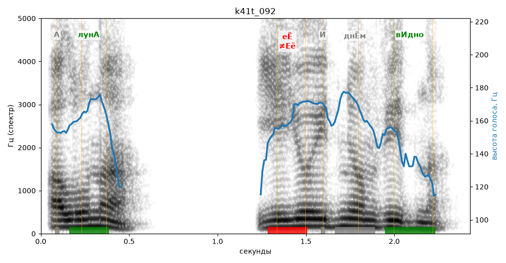

# k41t_092

Эталон: А луна? Её и днём видно.
Распознано: А Луна, ее и днем видно.
Слова: все совпали

## Ударения
(где нужно: ruaccent)

| слово | нужно | у голоса | |
|---|---|---|---|
| луна | лунА | лунА | ✓ |
| её | еЁ | Её | ✗ ОШИБКА |
| видно | вИдно | вИдно | ✓ |

## Интонация
- ✗ «а луна?» — нет вопросительного подъёма (самое высокое место — «луна», в начале) — звучит как утверждение
- ✓ «её и днём видно.» — конец фразы понижается — звучит законченно
- Диапазон голоса 5.6 полутонов (нормально), средняя высота 157 Гц

## Паузы и темп
- паузы на своих местах
- Темп 7.2 слога/с (быстро)

_Синяя линия — высота голоса. Над словами заглавная буква — где ударение должно быть; красным — голос поставил не туда (уверенно), оранжевым — возможно._
