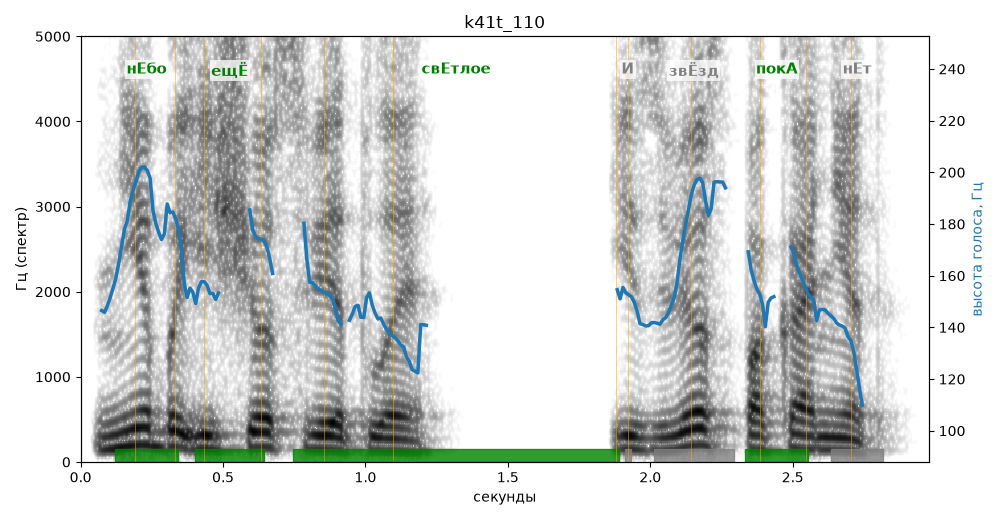

# k41t_110

Эталон: Небо ещё светлое. И звёзд пока нет.
Распознано: Неба еще светлое. Извест пока нет.
Расхождения в словах: «небо» → «неба»; «и звезд» → «извест»

## Ударения
(где нужно: ruaccent)

| слово | нужно | у голоса | |
|---|---|---|---|
| небо | нЕбо | нЕбо | ✓ |
| ещё | ещЁ | ещЁ | ✓ |
| светлое | свЕтлое | свЕтлое | ✓ |
| пока | покА | покА | ✓ |

## Интонация
- ✗ «небо ещё светлое.» — конец фразы не понижается — звучит незаконченно / как перечисление
- ✓ «и звёзд пока нет.» — конец фразы понижается — звучит законченно
- Диапазон голоса 6.9 полутонов (нормально), средняя высота 153 Гц

## Паузы и темп
- после «светлое.» пауза всего 0.02 с — фразы слипаются
- Темп 4.5 слога/с (нормально)

_Синяя линия — высота голоса. Над словами заглавная буква — где ударение должно быть; красным — голос поставил не туда (уверенно), оранжевым — возможно._
