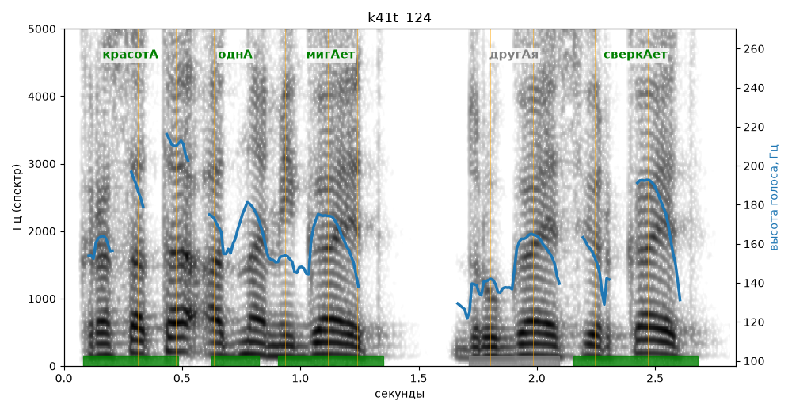

# k41t_124

Эталон: Красота! Одна мигает, другая сверкает!
Распознано: Красота однамегает, другая сверкает.
Расхождения в словах: «одна мигает» → «однамегает»

## Ударения
(где нужно: ruaccent)

| слово | нужно | у голоса | |
|---|---|---|---|
| красота | красотА | красотА | ✓ |
| одна | однА | однА | ✓ |
| мигает | мигАет | мигАет | ✓ |
| другая | другАя | — | ? |
| сверкает | сверкАет | сверкАет | ✓ |

## Интонация
- ✓ «красота!» — выделено слово «красота» (+2.0 пт)
- ✓ «одна мигает другая сверкает!» — выделено слово «сверкает» (+3.0 пт)
- Диапазон голоса 7.3 полутонов (живо), средняя высота 160 Гц

## Паузы и темп
- после «красота!» пауза всего 0.14 с — фразы слипаются
- Темп 5.8 слога/с (нормально)

_Синяя линия — высота голоса. Над словами заглавная буква — где ударение должно быть; красным — голос поставил не туда (уверенно), оранжевым — возможно._
