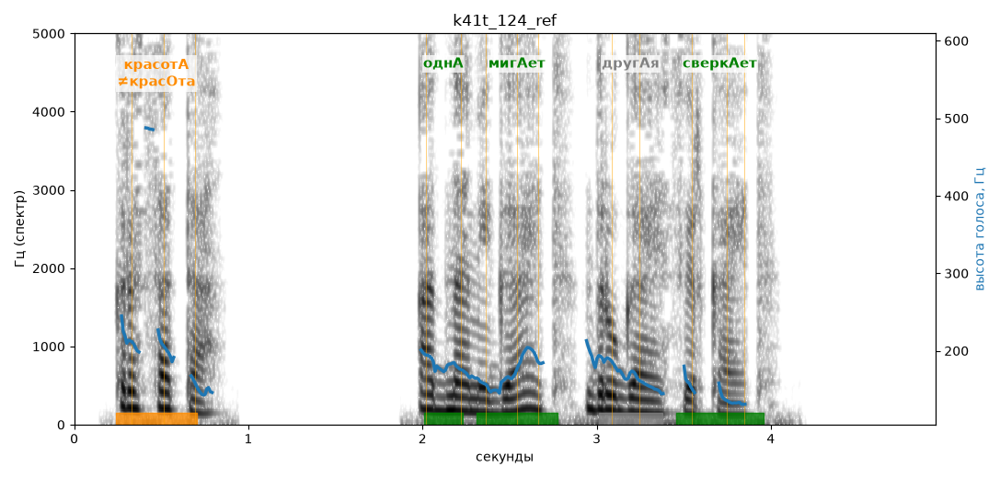

# k41t_124_ref

Голос: **edge:ru-RU-SvetlanaNeural** · длительность 4.9 с
Эталон: Красота! Одна мигает, другая сверкает!
Распознано: красота. Одна мигает, другая сверкает.
Слова: все совпали

## Ударения
(где нужно: ruaccent)

| слово | нужно | у голоса | |
|---|---|---|---|
| красота | красотА | красОта | ✗? возможно — послушать |
| одна | однА | однА | ✓ |
| мигает | мигАет | мигАет | ✓ |
| другая | другАя | — | ? |
| сверкает | сверкАет | сверкАет | ✓ |

## Интонация
- ✗ «красота!» — восклицание звучит ровно, без эмоции
- ✗ «одна мигает другая сверкает!» — восклицание звучит ровно, без эмоции
- Диапазон голоса 8.3 полутонов (живо), средняя высота 173 Гц

## Паузы и темп
- паузы на своих местах
- Темп 6.0 слога/с (нормально)

_Синяя линия — высота голоса. Над словами заглавная буква — где ударение должно быть; красным — голос поставил не туда (уверенно), оранжевым — возможно._
