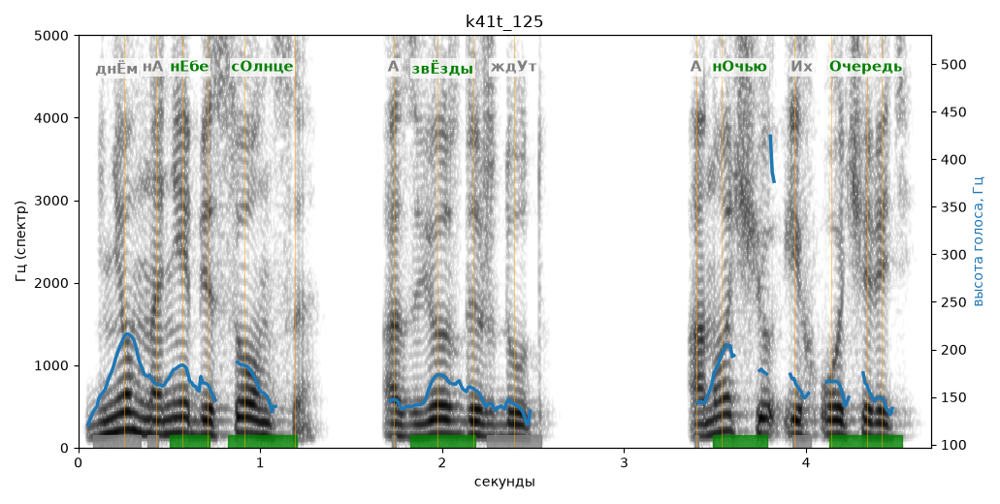

# k41t_125

Эталон: Днём на небе солнце, а звёзды ждут. А ночью их очередь!
Распознано: Днем на небе солнце, а звезды ждут. Оночью их очередь.
Расхождения в словах: «а ночью» → «оночью»

## Ударения
(где нужно: ruaccent)

| слово | нужно | у голоса | |
|---|---|---|---|
| небе | нЕбе | нЕбе | ✓ |
| солнце | сОлнце | сОлнце | ✓ |
| звёзды | звЁзды | звЁзды | ✓ |
| ночью | нОчью | нОчью | ✓ |
| очередь | Очередь | Очередь | ✓ |

## Интонация
- ✓ «днём на небе солнце а звёзды ждут.» — конец фразы понижается — звучит законченно
- ✓ «а ночью их очередь!» — выделено слово «ночью» (+3.4 пт)
- Диапазон голоса 7.1 полутонов (живо), средняя высота 161 Гц

## Паузы и темп
- паузы на своих местах
- Темп 5.2 слога/с (нормально)

_Синяя линия — высота голоса. Над словами заглавная буква — где ударение должно быть; красным — голос поставил не туда (уверенно), оранжевым — возможно._
