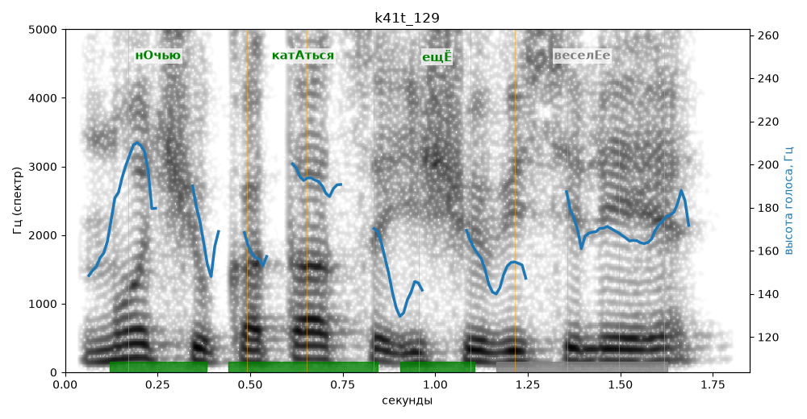

# k41t_129

Эталон: Ночью кататься ещё веселее!
Распознано: Ночью кататься еще веселее.
Слова: все совпали

## Ударения
(где нужно: ruaccent)

| слово | нужно | у голоса | |
|---|---|---|---|
| ночью | нОчью | нОчью | ✓ |
| кататься | катАться | катАться | ✓ |
| ещё | ещЁ | ещЁ | ✓ |
| веселее | веселЕе | веселеЕ | ? не разобрать |

## Интонация
- ✓ «ночью кататься ещё веселее!» — выделено слово «кататься» (+2.6 пт)
- Диапазон голоса 6.1 полутонов (нормально), средняя высота 168 Гц

## Паузы и темп
- паузы на своих местах
- Темп 6.6 слога/с (быстро)

_Синяя линия — высота голоса. Над словами заглавная буква — где ударение должно быть; красным — голос поставил не туда (уверенно), оранжевым — возможно._
