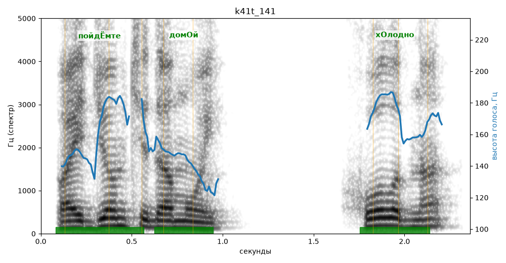

# k41t_141

Эталон: Пойдёмте домой. Холодно!
Распознано: Пойдемте домой. Холодно.
Слова: все совпали

## Ударения
(где нужно: ruaccent)

| слово | нужно | у голоса | |
|---|---|---|---|
| пойдёмте | пойдЁмте | пойдЁмте | ✓ |
| домой | домОй | домОй | ✓ |
| холодно | хОлодно | хОлодно | ✓ |

## Интонация
- ✓ «пойдёмте домой.» — конец фразы понижается — звучит законченно
- ✗ «холодно!» — восклицание звучит ровно, без эмоции
- Диапазон голоса 6.3 полутонов (нормально), средняя высота 157 Гц

## Паузы и темп
- паузы на своих местах
- Темп 6.4 слога/с (нормально)

_Синяя линия — высота голоса. Над словами заглавная буква — где ударение должно быть; красным — голос поставил не туда (уверенно), оранжевым — возможно._
