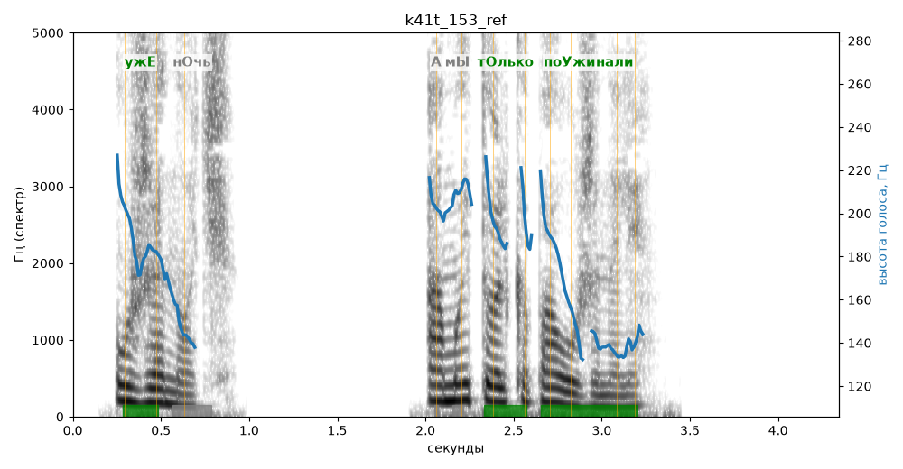

# k41t_153_ref

Голос: **edge:ru-RU-SvetlanaNeural** · длительность 4.3 с
Эталон: Уж+е ночь. А мы только поужинали.
Распознано: Уже ночь. А мы только поужинали.
Слова: все совпали

## Ударения
(где нужно: ruaccent)

| слово | нужно | у голоса | |
|---|---|---|---|
| уже | ужЕ | ужЕ | ✓ |
| только | тОлько | тОлько | ✓ |
| поужинали | поУжинали | поУжинали | ✓ |

## Интонация
- ✓ «уже ночь.» — конец фразы понижается — звучит законченно
- ✓ «а мы только поужинали.» — конец фразы понижается — звучит законченно
- Диапазон голоса 8.1 полутонов (живо), средняя высота 181 Гц

## Паузы и темп
- паузы на своих местах
- Темп 7.3 слога/с (быстро)

_Синяя линия — высота голоса. Над словами заглавная буква — где ударение должно быть; красным — голос поставил не туда (уверенно), оранжевым — возможно._
