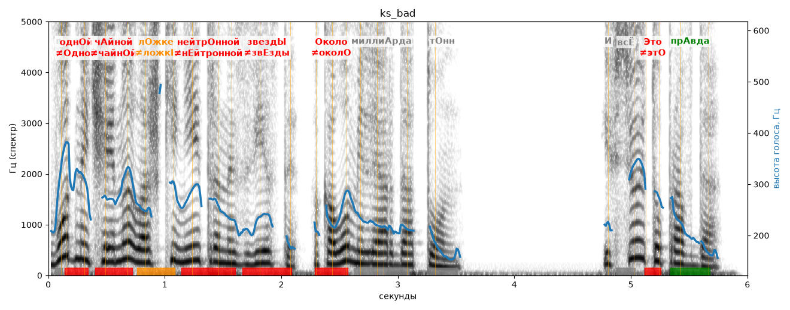

# ks_bad

Голос: **silero:kseniya** · длительность 6.0 с
Естественность (UTMOS): **3.24 из 5** (живой диктор ≈ 4–4.5)
Эталон: В одн+ой ч+айной л+ожке нейтр+онной звезд+ы, +около милли+арда тонн. И всё +это пр+авда!
Распознано: Водный чайной ложки нейтран из везды, около миллиарда тонн. И всё это правда.
Расхождения в словах: «в одной» → «водный»; «ложке нейтронной звезды» → «ложки нейтран из везды»

## Ударения
(где нужно: дано в тексте)

| слово | нужно | у голоса | |
|---|---|---|---|
| одной | однОй | Одной | ✗ ОШИБКА |
| чайной | чАйной | чайнОй | ✗ ОШИБКА |
| ложке | лОжке | ложкЕ | ✗? возможно — послушать |
| нейтронной | нейтрОнной | нЕйтронной | ✗ ОШИБКА |
| звезды | звездЫ | звЕзды | ✗ ОШИБКА |
| около | Около | околО | ✗ ОШИБКА |
| миллиарда | миллиАрда | миллиардА | ? не разобрать |
| это | Это | этО | ✗ ОШИБКА |
| правда | прАвда | прАвда | ✓ |

## Интонация
- ✓ «в одной чайной ложке нейтронной звезды около миллиарда тонн.» — конец фразы понижается — звучит законченно
- ✓ «и всё это правда!» — выделено слово «всё» (+5.6 пт)
- Диапазон голоса 12.3 полутонов (живо), средняя высота 235 Гц

## Паузы и темп
- паузы на своих местах
- Темп 6.5 слога/с (нормально)

_Синяя линия — высота голоса. Над словами заглавная буква — где ударение должно быть; красным — голос поставил не туда (уверенно), оранжевым — возможно._
