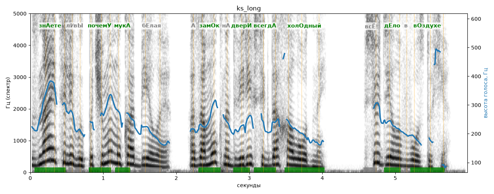

# ks_long

Голос: **silero:kseniya** · длительность 6.0 с
Естественность (UTMOS): **3.56 из 5** (живой диктор ≈ 4–4.5)
Эталон: Знаете ли вы, почему мук+а белая, а зам+ок на двери всегда холодный? Всё дело в воздухе.
Распознано: Знаете ли вы, почему мука белая, а замок на двери всегда холодный? Все дело в воздухе.
Слова: все совпали

## Ударения
(где нужно: ruaccent)

| слово | нужно | у голоса | |
|---|---|---|---|
| знаете | знАете | знАете | ✓ |
| почему | почемУ | почемУ | ✓ |
| мука | мукА | мукА | ✓ |
| белая | бЕлая | — | ? |
| замок | замОк | замОк | ✓ |
| двери | дверИ | дверИ | ✓ |
| всегда | всегдА | всегдА | ✓ |
| холодный | холОдный | холОдный | ✓ |
| дело | дЕло | дЕло | ✓ |
| воздухе | вОздухе | вОздухе | ✓ |

## Интонация
- ✓ «знаете ли вы почему мука белая а замок на двери всегда холодный?» — вопросительный подъём на слове «знаете»
- ✓ «всё дело в воздухе.» — конец фразы понижается — звучит законченно
- Диапазон голоса 13.6 полутонов (живо), средняя высота 224 Гц

## Паузы и темп
- паузы на своих местах
- Темп 8.2 слога/с (быстро)

_Синяя линия — высота голоса. Над словами заглавная буква — где ударение должно быть; красным — голос поставил не туда (уверенно), оранжевым — возможно._
