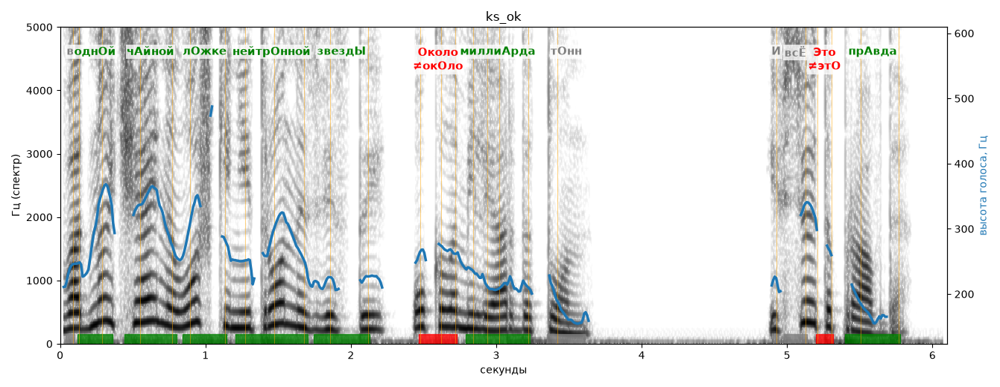

# ks_ok

Голос: **silero:kseniya** · длительность 6.1 с
Естественность (UTMOS): **3.92 из 5** (живой диктор ≈ 4–4.5)
Эталон: В одн+ой ч+айной л+ожке нейтр+онной звезд+ы, +около милли+арда тонн. И всё +это пр+авда!
Распознано: В одной чайной ложке нейтронной звезды около миллиарда тонн. И всё это правда.
Слова: все совпали

## Ударения
(где нужно: дано в тексте)

| слово | нужно | у голоса | |
|---|---|---|---|
| одной | однОй | однОй | ✓ |
| чайной | чАйной | чАйной | ✓ |
| ложке | лОжке | лОжке | ✓ |
| нейтронной | нейтрОнной | нейтрОнной | ✓ |
| звезды | звездЫ | звездЫ | ✓ |
| около | Около | окОло | ✗ ОШИБКА |
| миллиарда | миллиАрда | миллиАрда | ✓ (неуверенно) |
| это | Это | этО | ✗ ОШИБКА |
| правда | прАвда | прАвда | ✓ |

## Интонация
- ✓ «в одной чайной ложке нейтронной звезды около миллиарда тонн.» — конец фразы понижается — звучит законченно
- ✓ «и всё это правда!» — выделено слово «всё» (+5.9 пт)
- Диапазон голоса 13.3 полутонов (живо), средняя высота 246 Гц

## Паузы и темп
- паузы на своих местах
- Темп 7.4 слога/с (быстро)

_Синяя линия — высота голоса. Над словами: заглавная буква — где ударение должно быть; красным — где голос его поставил не туда._
