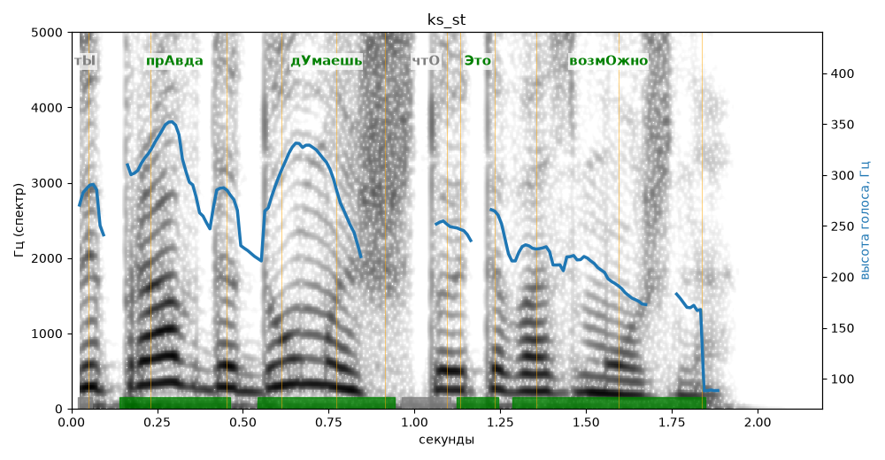

# ks_st

Голос: **silero:kseniya** · длительность 2.2 с
Естественность (UTMOS): **3.78 из 5** (живой диктор ≈ 4–4.5)
Эталон: Ты правда думаешь, что это возможно.
Распознано: Ты правда думаешь, что это возможно?
Слова: все совпали

## Ударения
(где нужно: ruaccent)

| слово | нужно | у голоса | |
|---|---|---|---|
| правда | прАвда | прАвда | ✓ |
| думаешь | дУмаешь | дУмаешь | ✓ |
| это | Это | Это | ✓ |
| возможно | возмОжно | возмОжно | ✓ |

## Интонация
- ✓ «ты правда думаешь что это возможно.» — конец фразы понижается — звучит законченно
- Диапазон голоса 11.6 полутонов (живо), средняя высота 249 Гц

## Паузы и темп
- после «думаешь,» нет паузы (0.02 с)
- Темп 7.6 слога/с (быстро)

_Синяя линия — высота голоса. Над словами: заглавная буква — где ударение должно быть; красным — где голос его поставил не туда._
