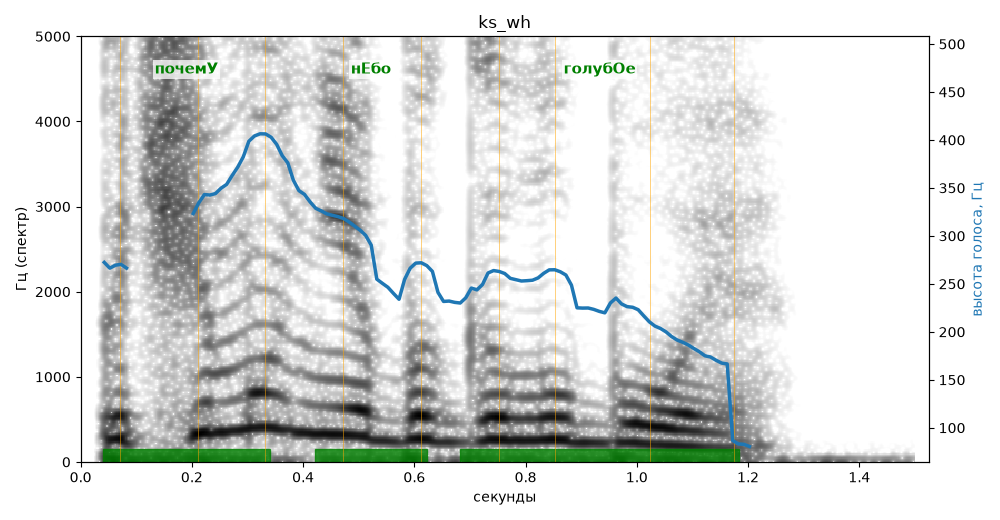

# ks_wh

Голос: **silero:kseniya** · длительность 1.5 с
Естественность (UTMOS): **3.31 из 5** (живой диктор ≈ 4–4.5)
Эталон: Почему небо голубое?
Распознано: Почему небо голубое?
Слова: все совпали

## Ударения
(где нужно: ruaccent)

| слово | нужно | у голоса | |
|---|---|---|---|
| почему | почемУ | почемУ | ✓ |
| небо | нЕбо | нЕбо | ✓ |
| голубое | голубОе | голубОе | ✓ |

## Интонация
- ✓ «почему небо голубое?» — конец фразы понижается — звучит законченно
- Диапазон голоса 14.7 полутонов (живо), средняя высота 256 Гц

## Паузы и темп
- паузы на своих местах
- Темп 7.9 слога/с (быстро)

_Синяя линия — высота голоса. Над словами заглавная буква — где ударение должно быть; красным — голос поставил не туда (уверенно), оранжевым — возможно._
