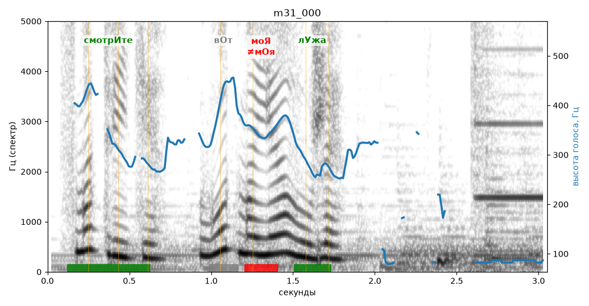

# m31_000

Голос: **Рон (серия 31, 0.2 с)** · длительность 3.1 с
Естественность (UTMOS): **1.91 из 5** (живой диктор ≈ 4–4.5)
Эталон: Смотрите! Вот моя лужа!
Распознано: Смотрите, вот моя лужа!
Слова: все совпали

## Ударения
(где нужно: ruaccent)

| слово | нужно | у голоса | |
|---|---|---|---|
| смотрите | смотрИте | смотрИте | ✓ |
| моя | моЯ | мОя | ✗ ОШИБКА |
| лужа | лУжа | лУжа | ✓ |

## Интонация
- ✗ «смотрите!» — восклицание звучит ровно, без эмоции
- ✓ «вот моя лужа!» — выделено слово «вот» (+2.9 пт)
- Диапазон голоса 28.7 полутонов (живо), средняя высота 307 Гц

## Паузы и темп
- паузы на своих местах
- Темп 5.6 слога/с (нормально)

_Синяя линия — высота голоса. Над словами заглавная буква — где ударение должно быть; красным — голос поставил не туда (уверенно), оранжевым — возможно._
