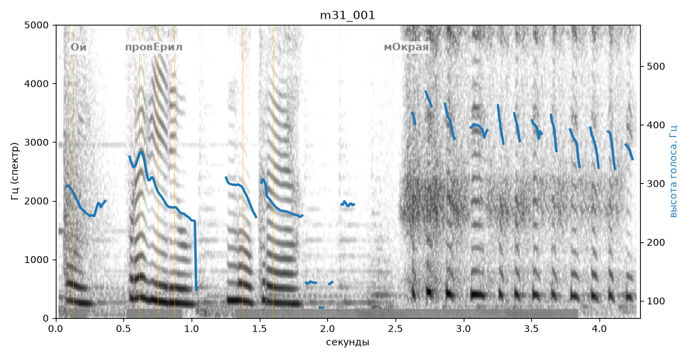

# m31_001

Голос: **Рон (серия 31, 3.4 с)** · длительность 4.3 с
Естественность (UTMOS): **1.29 из 5** (живой диктор ≈ 4–4.5)
Эталон: Ой. Проверил. Мокрая.
Распознано: Ой, проверю, мокрое.
Расхождения в словах: «проверил мокрая» → «проверю мокрое»

## Ударения
(где нужно: ruaccent)

| слово | нужно | у голоса | |
|---|---|---|---|
| проверил | провЕрил | проверИл | ? не разобрать |
| мокрая | мОкрая | — | ? |

## Интонация
- ✗ «проверил.» — конец фразы не понижается — звучит незаконченно / как перечисление
- Диапазон голоса 19.9 полутонов (живо), средняя высота 293 Гц

## Паузы и темп
- паузы на своих местах
- Темп 2.0 слога/с (медленно)

_Синяя линия — высота голоса. Над словами заглавная буква — где ударение должно быть; красным — голос поставил не туда (уверенно), оранжевым — возможно._
