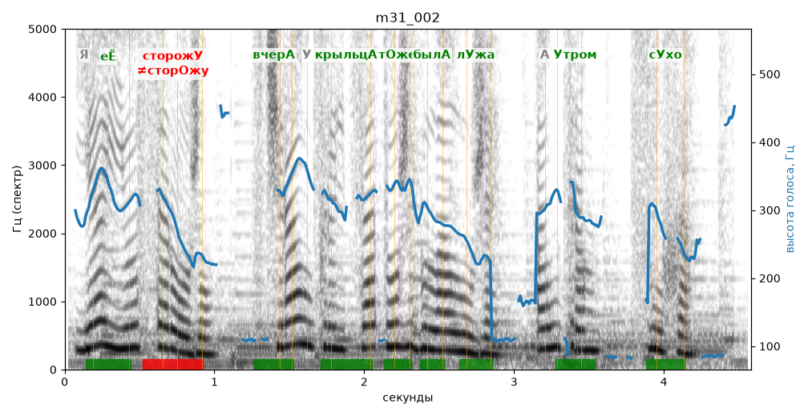

# m31_002

Голос: **Рон (серия 31, 7.8 с)** · длительность 4.6 с
Естественность (UTMOS): **1.35 из 5** (живой диктор ≈ 4–4.5)
Эталон: Я её сторожу. Вчера у крыльца тоже была лужа. А утром — сухо!
Распознано: Я её осторожу. Вчера у крыльца тоже была луже, а утром – сухо.
Расхождения в словах: «сторожу» → «осторожу»; «лужа» → «луже»

## Ударения
(где нужно: ruaccent)

| слово | нужно | у голоса | |
|---|---|---|---|
| её | еЁ | еЁ | ✓ |
| сторожу | сторожУ | сторОжу | ✗ ОШИБКА |
| вчера | вчерА | вчерА | ✓ |
| крыльца | крыльцА | крыльцА | ✓ |
| тоже | тОже | тОже | ✓ |
| была | былА | былА | ✓ |
| лужа | лУжа | лУжа | ✓ |
| утром | Утром | Утром | ✓ |
| сухо | сУхо | сУхо | ✓ |

## Интонация
- ✓ «я её сторожу.» — конец фразы понижается — звучит законченно
- ✓ «вчера у крыльца тоже была лужа.» — конец фразы понижается — звучит законченно
- ✗ «а утром сухо!» — восклицание звучит ровно, без эмоции
- Диапазон голоса 25.2 полутонов (живо), средняя высота 289 Гц

## Паузы и темп
- паузы на своих местах
- Темп 7.0 слога/с (быстро)

_Синяя линия — высота голоса. Над словами заглавная буква — где ударение должно быть; красным — голос поставил не туда (уверенно), оранжевым — возможно._
