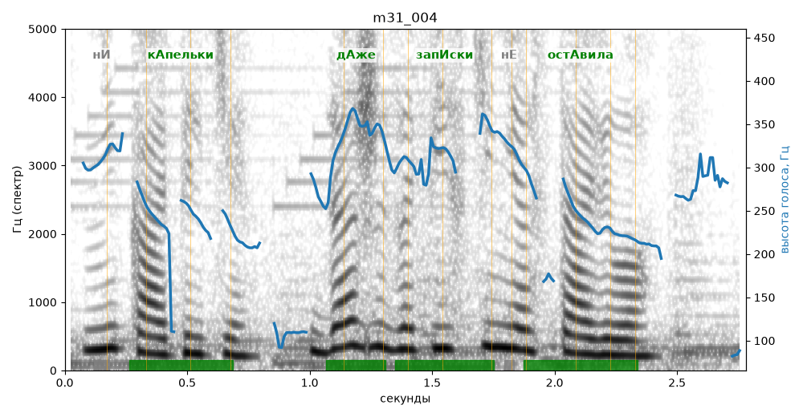

# m31_004

Голос: **Рон (серия 31, 17.0 с)** · длительность 2.8 с
Естественность (UTMOS): **2.35 из 5** (живой диктор ≈ 4–4.5)
Эталон: Ни капельки. Даже записки не оставила.
Распознано: Не капельки, даже записки не оставила.
Расхождения в словах: «ни» → «не»

## Ударения
(где нужно: ruaccent)

| слово | нужно | у голоса | |
|---|---|---|---|
| капельки | кАпельки | кАпельки | ✓ |
| даже | дАже | дАже | ✓ |
| записки | запИски | запИски | ✓ |
| оставила | остАвила | остАвила | ✓ |

## Интонация
- ✗ «ни капельки.» — конец фразы не понижается — звучит незаконченно / как перечисление
- ✓ «даже записки не оставила.» — конец фразы понижается — звучит законченно
- Диапазон голоса 20.1 полутонов (живо), средняя высота 268 Гц

## Паузы и темп
- паузы на своих местах
- Темп 7.6 слога/с (быстро)

_Синяя линия — высота голоса. Над словами заглавная буква — где ударение должно быть; красным — голос поставил не туда (уверенно), оранжевым — возможно._
