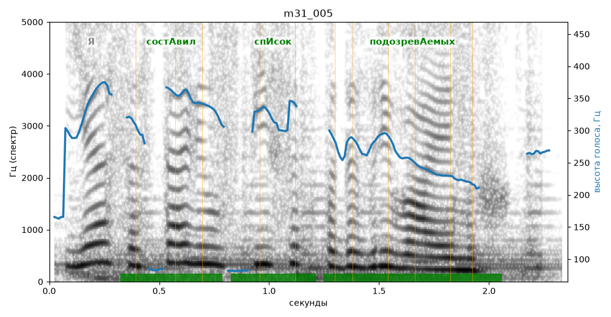

# m31_005

Голос: **Рон (серия 31, 19.9 с)** · длительность 2.4 с
Естественность (UTMOS): **1.42 из 5** (живой диктор ≈ 4–4.5)
Эталон: Я составил список подозреваемых.
Распознано: Я составил список подозреваемых.
Слова: все совпали

## Ударения
(где нужно: ruaccent)

| слово | нужно | у голоса | |
|---|---|---|---|
| составил | состАвил | состАвил | ✓ |
| список | спИсок | спИсок | ✓ |
| подозреваемых | подозревАемых | подозревАемых | ✓ |

## Интонация
- ✓ «я составил список подозреваемых.» — конец фразы понижается — звучит законченно
- Диапазон голоса 25.6 полутонов (живо), средняя высота 285 Гц

## Паузы и темп
- паузы на своих местах
- Темп 5.9 слога/с (нормально)

_Синяя линия — высота голоса. Над словами заглавная буква — где ударение должно быть; красным — голос поставил не туда (уверенно), оранжевым — возможно._
