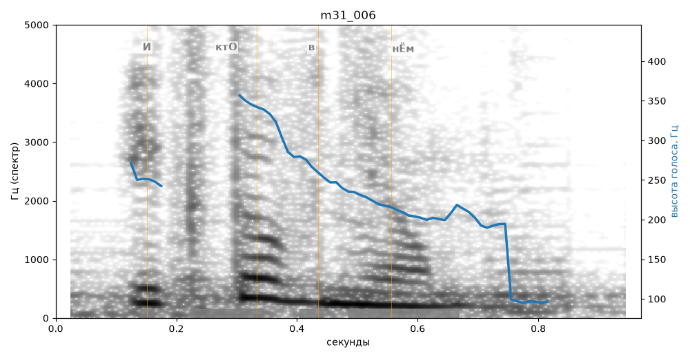

# m31_006

Голос: **Барсик (серия 31, 22.4 с)** · длительность 1.0 с
Естественность (UTMOS): **2.25 из 5** (живой диктор ≈ 4–4.5)
Эталон: И кто в нём?
Распознано: И кто в нём?
Слова: все совпали

## Ударения
(где нужно: дано в тексте)

| слово | нужно | у голоса | |
|---|---|---|---|

## Интонация
- ✗ «и кто в нём?» — нет вопросительного подъёма (самое высокое место — «кто», в начале) — звучит как утверждение
- Диапазон голоса 21.9 полутонов (живо), средняя высота 222 Гц

## Паузы и темп
- паузы на своих местах
- Темп 7.6 слога/с (быстро)

_Синяя линия — высота голоса. Над словами заглавная буква — где ударение должно быть; красным — голос поставил не туда (уверенно), оранжевым — возможно._
