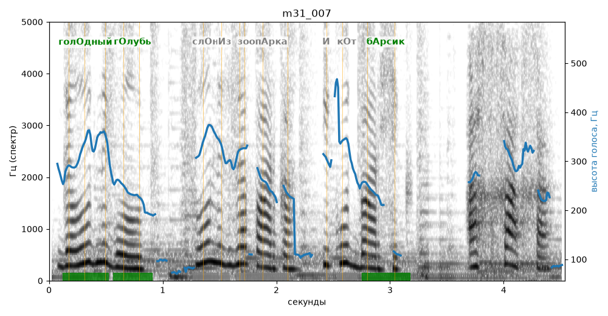

# m31_007

Голос: **Рон (серия 31, 23.5 с)** · длительность 4.5 с
Естественность (UTMOS): **1.52 из 5** (живой диктор ≈ 4–4.5)
Эталон: Голодный голубь. Слон из зоопарка. И кот Барсик.
Распознано: Голодный голод, слон из-за парка и кот-барсик. Ахаха!
Расхождения в словах: «голубь» → «голод»; «из зоопарка» → «из-за парка»; «кот барсик» → «кот-барсик ахаха»

## Ударения
(где нужно: ruaccent)

| слово | нужно | у голоса | |
|---|---|---|---|
| голодный | голОдный | голОдный | ✓ |
| голубь | гОлубь | гОлубь | ✓ |
| зоопарка | зоопАрка | зоопаркА | ? не разобрать |
| барсик | бАрсик | бАрсик | ✓ |

## Интонация
- ✓ «голодный голубь.» — конец фразы понижается — звучит законченно
- ✓ «слон из зоопарка.» — конец фразы понижается — звучит законченно
- ✓ «и кот барсик.» — конец фразы понижается — звучит законченно
- Диапазон голоса 25.3 полутонов (живо), средняя высота 261 Гц

## Паузы и темп
- паузы на своих местах
- Темп 6.3 слога/с (нормально)

_Синяя линия — высота голоса. Над словами заглавная буква — где ударение должно быть; красным — голос поставил не туда (уверенно), оранжевым — возможно._
