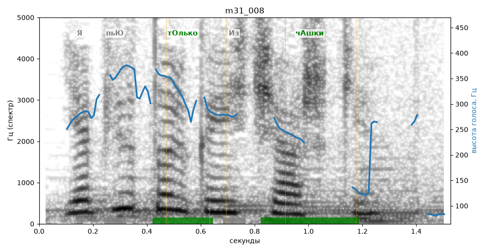

# m31_008

Голос: **Барсик (серия 31, 28.1 с)** · длительность 1.5 с
Естественность (UTMOS): **1.76 из 5** (живой диктор ≈ 4–4.5)
Эталон: Я пью только из чашки!
Распознано: Я пью только из чашки.
Слова: все совпали

## Ударения
(где нужно: ruaccent)

| слово | нужно | у голоса | |
|---|---|---|---|
| только | тОлько | тОлько | ✓ |
| чашки | чАшки | чАшки | ✓ |

## Интонация
- ✓ «я пью только из чашки!» — выделено слово «только» (+3.3 пт)
- Диапазон голоса 25.7 полутонов (живо), средняя высота 278 Гц

## Паузы и темп
- паузы на своих местах
- Темп 4.8 слога/с (нормально)

_Синяя линия — высота голоса. Над словами заглавная буква — где ударение должно быть; красным — голос поставил не туда (уверенно), оранжевым — возможно._
