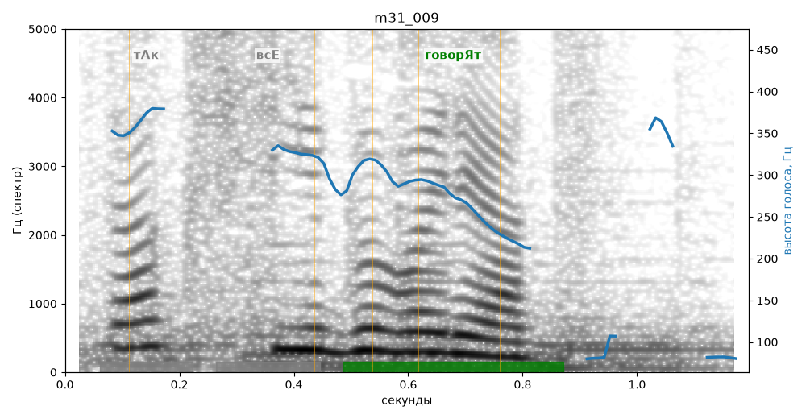

# m31_009

Голос: **Рон (серия 31, 29.8 с)** · длительность 1.2 с
Естественность (UTMOS): **1.57 из 5** (живой диктор ≈ 4–4.5)
Эталон: Так все говорят.
Распознано: Так все говорят.
Слова: все совпали

## Ударения
(где нужно: ruaccent)

| слово | нужно | у голоса | |
|---|---|---|---|
| говорят | говорЯт | говорЯт | ✓ |

## Интонация
- ✓ «так все говорят.» — конец фразы понижается — звучит законченно
- Диапазон голоса 26.3 полутонов (живо), средняя высота 292 Гц

## Паузы и темп
- паузы на своих местах
- Темп 6.2 слога/с (нормально)

_Синяя линия — высота голоса. Над словами заглавная буква — где ударение должно быть; красным — голос поставил не туда (уверенно), оранжевым — возможно._
