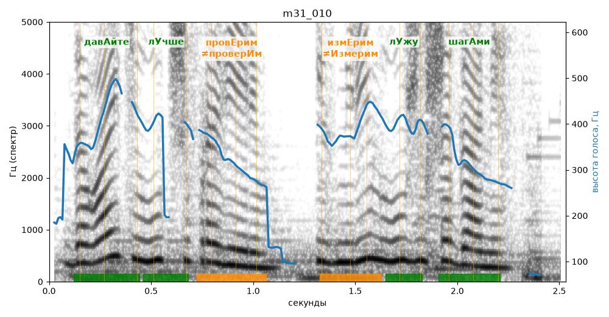

# m31_010

Голос: **Пик (серия 31, 31.1 с)** · длительность 2.5 с
Естественность (UTMOS): **1.34 из 5** (живой диктор ≈ 4–4.5)
Эталон: Давайте лучше проверим. Измерим лужу шагами.
Распознано: Давайте лучше проверим. Измерим мы уже в шагами.
Расхождения в словах: «лужу» → «мы уже в»

## Ударения
(где нужно: ruaccent)

| слово | нужно | у голоса | |
|---|---|---|---|
| давайте | давАйте | давАйте | ✓ |
| лучше | лУчше | лУчше | ✓ |
| проверим | провЕрим | проверИм | ✗? возможно — послушать |
| измерим | измЕрим | Измерим | ✗? возможно — послушать |
| лужу | лУжу | лУжу | ✓ |
| шагами | шагАми | шагАми | ✓ |

## Интонация
- ✓ «давайте лучше проверим.» — конец фразы понижается — звучит законченно
- ✓ «измерим лужу шагами.» — конец фразы понижается — звучит законченно
- Диапазон голоса 26.5 полутонов (живо), средняя высота 361 Гц

## Паузы и темп
- паузы на своих местах
- Темп 8.8 слога/с (быстро)

_Синяя линия — высота голоса. Над словами заглавная буква — где ударение должно быть; красным — голос поставил не туда (уверенно), оранжевым — возможно._
