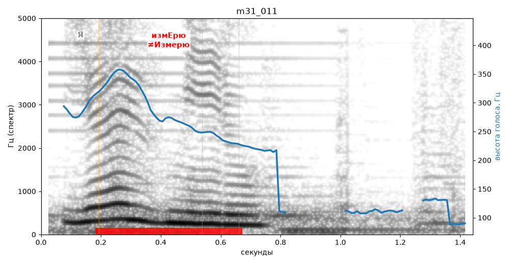

# m31_011

Голос: **Рон (серия 31, 33.7 с)** · длительность 1.4 с
Естественность (UTMOS): **2.03 из 5** (живой диктор ≈ 4–4.5)
Эталон: Я измерю!
Распознано: Я из мира.
Расхождения в словах: «измерю» → «из мира»

## Ударения
(где нужно: ruaccent)

| слово | нужно | у голоса | |
|---|---|---|---|
| измерю | измЕрю | Измерю | ✗ ОШИБКА |

## Интонация
- ✗ «я измерю!» — восклицание звучит ровно, без эмоции
- Диапазон голоса 21.9 полутонов (живо), средняя высота 232 Гц

## Паузы и темп
- паузы на своих местах
- Темп 5.5 слога/с (нормально)

_Синяя линия — высота голоса. Над словами заглавная буква — где ударение должно быть; красным — голос поставил не туда (уверенно), оранжевым — возможно._
