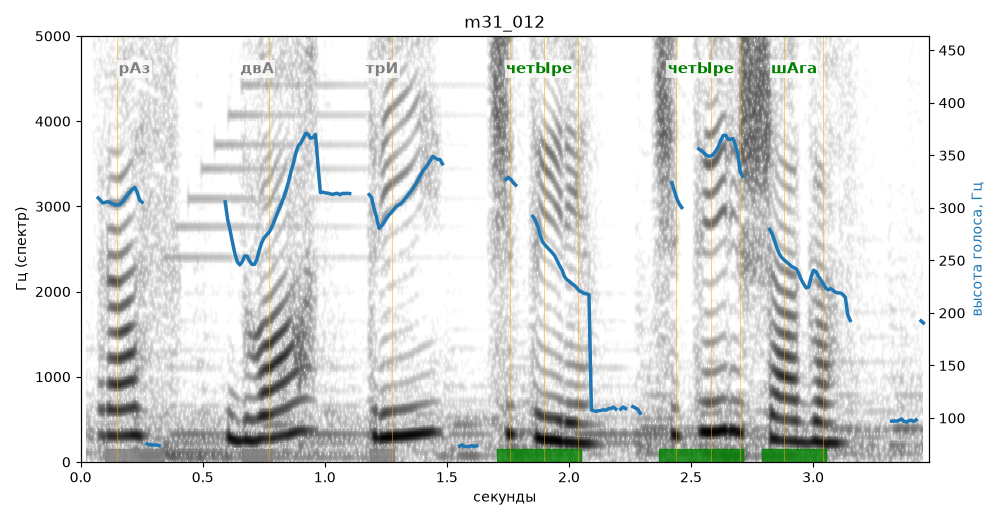

# m31_012

Голос: **Рон (серия 31, 35.3 с)** · длительность 3.5 с
Естественность (UTMOS): **2.0 из 5** (живой диктор ≈ 4–4.5)
Эталон: Раз, два, три, четыре! Четыре шага!
Распознано: Раз, два, три, четыре. Четыре шага.
Слова: все совпали

## Ударения
(где нужно: ruaccent)

| слово | нужно | у голоса | |
|---|---|---|---|
| четыре | четЫре | четЫре | ✓ |
| четыре | четЫре | четЫре | ✓ |
| шага | шАга | шАга | ✓ |

## Интонация
- ✗ «раз два три четыре!» — восклицание звучит ровно, без эмоции
- ✓ «четыре шага!» — выделено слово «четыре» (+2.4 пт)
- Диапазон голоса 27.4 полутонов (живо), средняя высота 280 Гц

## Паузы и темп
- паузы на своих местах
- Темп 7.4 слога/с (быстро)

_Синяя линия — высота голоса. Над словами заглавная буква — где ударение должно быть; красным — голос поставил не туда (уверенно), оранжевым — возможно._
