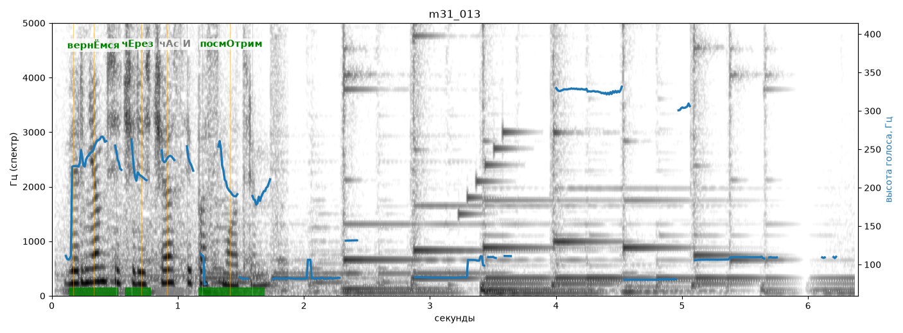

# m31_013

Голос: **Барсик (серия 31, 38.9 с)** · длительность 6.4 с
Естественность (UTMOS): **1.82 из 5** (живой диктор ≈ 4–4.5)
Эталон: Вернёмся через час и посмотрим.
Распознано: Вернемся через час и посмотрим.
Слова: все совпали

## Ударения
(где нужно: ruaccent)

| слово | нужно | у голоса | |
|---|---|---|---|
| вернёмся | вернЁмся | вернЁмся | ✓ |
| через | чЕрез | чЕрез | ✓ |
| посмотрим | посмОтрим | посмОтрим | ✓ |

## Интонация
- ✓ «вернёмся через час и посмотрим.» — конец фразы понижается — звучит законченно
- Диапазон голоса 24.4 полутонов (живо), средняя высота 109 Гц

## Паузы и темп
- паузы на своих местах
- Темп 6.5 слога/с (нормально)

_Синяя линия — высота голоса. Над словами заглавная буква — где ударение должно быть; красным — голос поставил не туда (уверенно), оранжевым — возможно._
