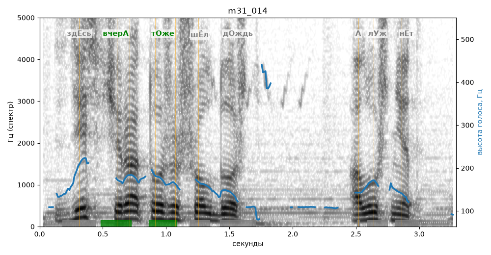

# m31_014

Голос: **Топа (серия 31, 45.4 с)** · длительность 3.3 с
Естественность (UTMOS): **3.12 из 5** (живой диктор ≈ 4–4.5)
Эталон: Здесь вчера тоже шёл дождь. А луж нет.
Распознано: Здесь вчера тоже шел дождь. А Луше нет.
Расхождения в словах: «луж» → «луше»

## Ударения
(где нужно: ruaccent)

| слово | нужно | у голоса | |
|---|---|---|---|
| вчера | вчерА | вчерА | ✓ |
| тоже | тОже | тОже | ✓ |

## Интонация
- ✓ «здесь вчера тоже шёл дождь.» — конец фразы понижается — звучит законченно
- ✗ «а луж нет.» — конец фразы не понижается — звучит незаконченно / как перечисление
- Диапазон голоса 12.6 полутонов (живо), средняя высота 151 Гц

## Паузы и темп
- паузы на своих местах
- Темп 5.0 слога/с (нормально)

_Синяя линия — высота голоса. Над словами заглавная буква — где ударение должно быть; красным — голос поставил не туда (уверенно), оранжевым — возможно._
