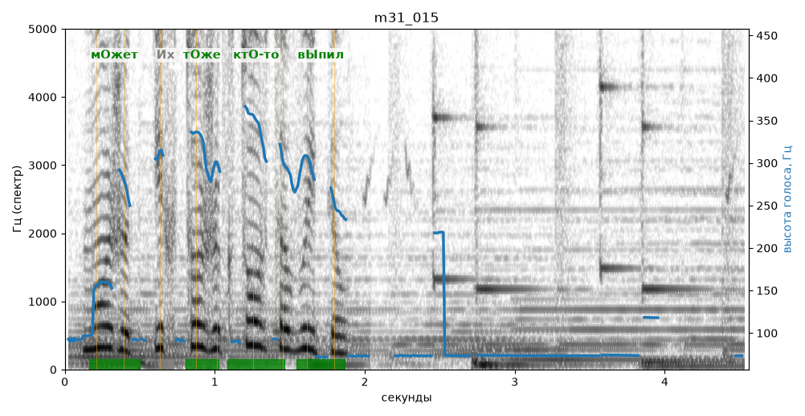

# m31_015

Голос: **Филя (серия 31, 48.8 с)** · длительность 4.6 с
Естественность (UTMOS): **1.48 из 5** (живой диктор ≈ 4–4.5)
Эталон: Может, их тоже кто-то выпил?
Распознано: Может, их тоже кто-то выпил.
Слова: все совпали

## Ударения
(где нужно: ruaccent)

| слово | нужно | у голоса | |
|---|---|---|---|
| может | мОжет | мОжет | ✓ |
| тоже | тОже | тОже | ✓ |
| кто-то | ктО-то | ктО-то | ✓ |
| выпил | вЫпил | вЫпил | ✓ |

## Интонация
- ✓ «может их тоже кто-то выпил?» — вопросительный подъём на слове «кто-то»
- Диапазон голоса 26.4 полутонов (живо), средняя высота 74 Гц

## Паузы и темп
- паузы на своих местах
- Темп 5.3 слога/с (нормально)

_Синяя линия — высота голоса. Над словами заглавная буква — где ударение должно быть; красным — голос поставил не туда (уверенно), оранжевым — возможно._
