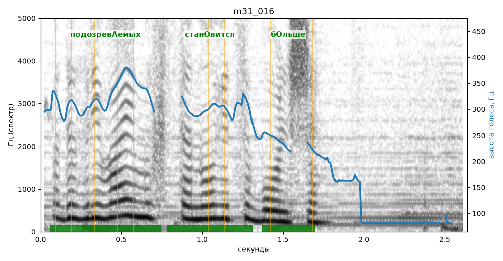

# m31_016

Голос: **Рон (серия 31, 53.5 с)** · длительность 2.6 с
Естественность (UTMOS): **2.07 из 5** (живой диктор ≈ 4–4.5)
Эталон: Подозреваемых становится больше.
Распознано: Подозреваемых становится больше.
Слова: все совпали

## Ударения
(где нужно: ruaccent)

| слово | нужно | у голоса | |
|---|---|---|---|
| подозреваемых | подозревАемых | подозревАемых | ✓ |
| становится | станОвится | станОвится | ✓ |
| больше | бОльше | бОльше | ✓ |

## Интонация
- ✓ «подозреваемых становится больше.» — конец фразы понижается — звучит законченно
- Диапазон голоса 25.3 полутонов (живо), средняя высота 278 Гц

## Паузы и темп
- паузы на своих местах
- Темп 7.4 слога/с (быстро)

_Синяя линия — высота голоса. Над словами заглавная буква — где ударение должно быть; красным — голос поставил не туда (уверенно), оранжевым — возможно._
