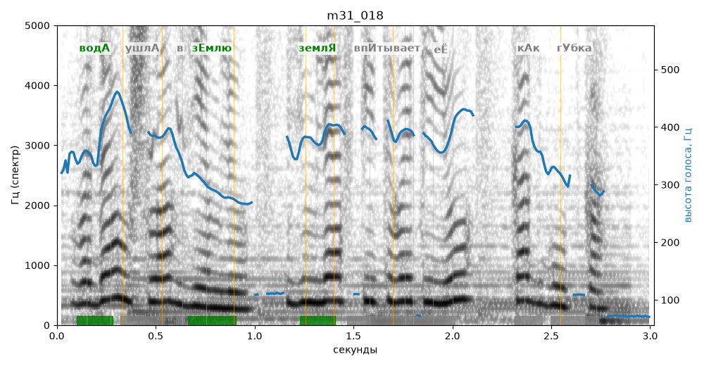

# m31_018

Голос: **Пик (серия 31, 57.7 с)** · длительность 3.0 с
Естественность (UTMOS): **1.36 из 5** (живой диктор ≈ 4–4.5)
Эталон: Вода ушла в землю. Земля впитывает её, как губка.
Распознано: Вода ушла в землю, земля впитывает ее как губка.
Слова: все совпали

## Ударения
(где нужно: ruaccent)

| слово | нужно | у голоса | |
|---|---|---|---|
| вода | водА | водА | ✓ |
| ушла | ушлА | Ушла | ? не разобрать |
| землю | зЕмлю | зЕмлю | ✓ |
| земля | землЯ | землЯ | ✓ |
| впитывает | впИтывает | впитываЕт | ? не разобрать |
| её | еЁ | Её | ? не разобрать |
| губка | гУбка | губкА | ? не разобрать |

## Интонация
- ✓ «вода ушла в землю.» — конец фразы понижается — звучит законченно
- ✓ «земля впитывает её как губка.» — конец фразы понижается — звучит законченно
- Диапазон голоса 30.9 полутонов (живо), средняя высота 356 Гц

## Паузы и темп
- паузы на своих местах
- Темп 8.9 слога/с (быстро)

_Синяя линия — высота голоса. Над словами заглавная буква — где ударение должно быть; красным — голос поставил не туда (уверенно), оранжевым — возможно._
