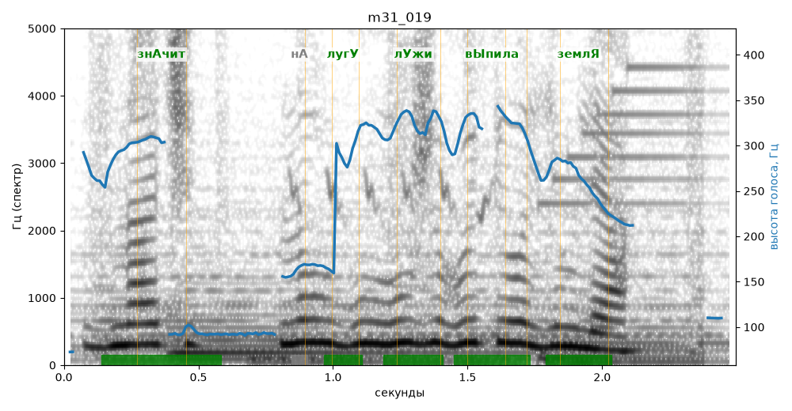

# m31_019

Голос: **Рон (серия 31, 60.9 с)** · длительность 2.5 с
Естественность (UTMOS): **1.32 из 5** (живой диктор ≈ 4–4.5)
Эталон: Значит, на лугу лужи выпила земля!
Распознано: Значит, на углу же выпила земля.
Расхождения в словах: «лугу лужи» → «углу же»

## Ударения
(где нужно: ruaccent)

| слово | нужно | у голоса | |
|---|---|---|---|
| значит | знАчит | знАчит | ✓ |
| лугу | лугУ | лугУ | ✓ |
| лужи | лУжи | лУжи | ✓ |
| выпила | вЫпила | вЫпила | ✓ |
| земля | землЯ | землЯ | ✓ |

## Интонация
- ✗ «значит на лугу лужи выпила земля!» — восклицание звучит ровно, без эмоции
- Диапазон голоса 22.4 полутонов (живо), средняя высота 276 Гц

## Паузы и темп
- паузы на своих местах
- Темп 7.4 слога/с (быстро)

_Синяя линия — высота голоса. Над словами заглавная буква — где ударение должно быть; красным — голос поставил не туда (уверенно), оранжевым — возможно._
