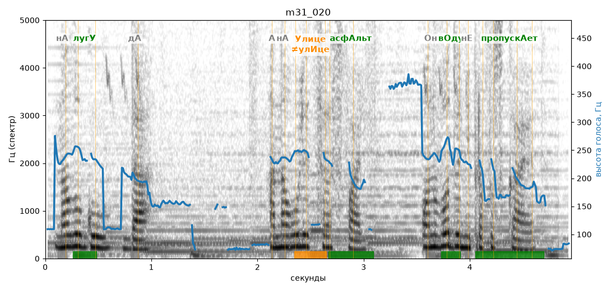

# m31_020

Голос: **Барсик (серия 31, 63.5 с)** · длительность 5.0 с
Естественность (UTMOS): **1.83 из 5** (живой диктор ≈ 4–4.5)
Эталон: На лугу — да. А на улице асфальт. Он воду не пропускает.
Распознано: На лугу, да. А на улице асфальт. Он воду не пропускает.
Слова: все совпали

## Ударения
(где нужно: ruaccent)

| слово | нужно | у голоса | |
|---|---|---|---|
| лугу | лугУ | лугУ | ✓ |
| улице | Улице | улИце | ✗? возможно — послушать |
| асфальт | асфАльт | асфАльт | ✓ |
| воду | вОду | вОду | ✓ |
| пропускает | пропускАет | пропускАет | ✓ |

## Интонация
- ✓ «на лугу да.» — конец фразы понижается — звучит законченно
- ✓ «а на улице асфальт.» — конец фразы понижается — звучит законченно
- ✓ «он воду не пропускает.» — конец фразы понижается — звучит законченно
- Диапазон голоса 27.8 полутонов (живо), средняя высота 194 Гц

## Паузы и темп
- паузы на своих местах
- Темп 7.6 слога/с (быстро)

_Синяя линия — высота голоса. Над словами заглавная буква — где ударение должно быть; красным — голос поставил не туда (уверенно), оранжевым — возможно._
