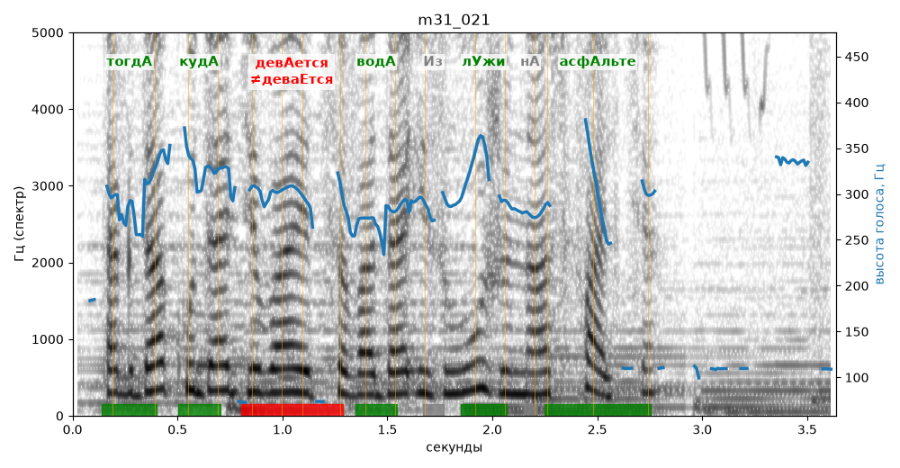

# m31_021

Голос: **Филя (серия 31, 68.6 с)** · длительность 3.6 с
Естественность (UTMOS): **2.11 из 5** (живой диктор ≈ 4–4.5)
Эталон: Тогда куда девается вода из лужи на асфальте?
Распознано: Тогда куда девается вода из лужи на асфальте?
Слова: все совпали

## Ударения
(где нужно: ruaccent)

| слово | нужно | у голоса | |
|---|---|---|---|
| тогда | тогдА | тогдА | ✓ |
| куда | кудА | кудА | ✓ |
| девается | девАется | деваЕтся | ✗ ОШИБКА |
| вода | водА | водА | ✓ |
| лужи | лУжи | лУжи | ✓ |
| асфальте | асфАльте | асфАльте | ✓ |

## Интонация
- ✗ «тогда куда девается вода из лужи на асфальте?» — нет вопросительного подъёма (самое высокое место — «куда», в начале) — звучит как утверждение
- Диапазон голоса 19.8 полутонов (живо), средняя высота 292 Гц

## Паузы и темп
- паузы на своих местах
- Темп 6.5 слога/с (нормально)

_Синяя линия — высота голоса. Над словами заглавная буква — где ударение должно быть; красным — голос поставил не туда (уверенно), оранжевым — возможно._
