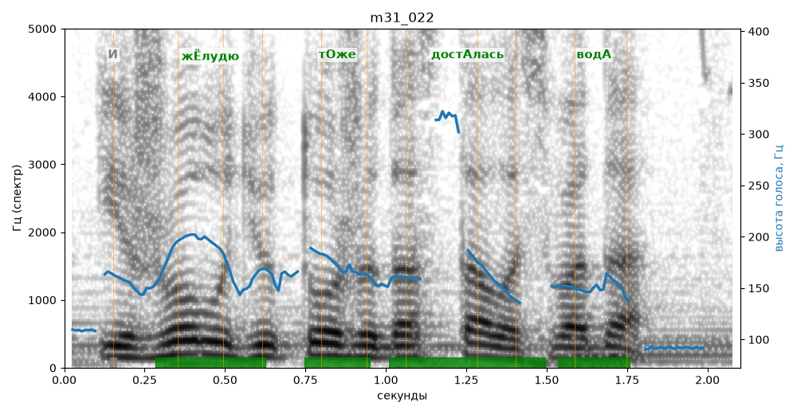

# m31_022

Голос: **Топа (серия 31, 72.3 с)** · длительность 2.1 с
Естественность (UTMOS): **2.82 из 5** (живой диктор ≈ 4–4.5)
Эталон: И жёлудю тоже досталась вода?
Распознано: и желудью тоже досталась вода.
Расхождения в словах: «желудю» → «желудью»

## Ударения
(где нужно: ruaccent)

| слово | нужно | у голоса | |
|---|---|---|---|
| жёлудю | жЁлудю | жЁлудю | ✓ |
| тоже | тОже | тОже | ✓ |
| досталась | достАлась | достАлась | ✓ |
| вода | водА | водА | ✓ |

## Интонация
- ✗ «и жёлудю тоже досталась вода?» — нет вопросительного подъёма (самое высокое место — «жёлудю», в начале) — звучит как утверждение
- Диапазон голоса 13.7 полутонов (живо), средняя высота 159 Гц

## Паузы и темп
- паузы на своих местах
- Темп 6.8 слога/с (быстро)

_Синяя линия — высота голоса. Над словами заглавная буква — где ударение должно быть; красным — голос поставил не туда (уверенно), оранжевым — возможно._
