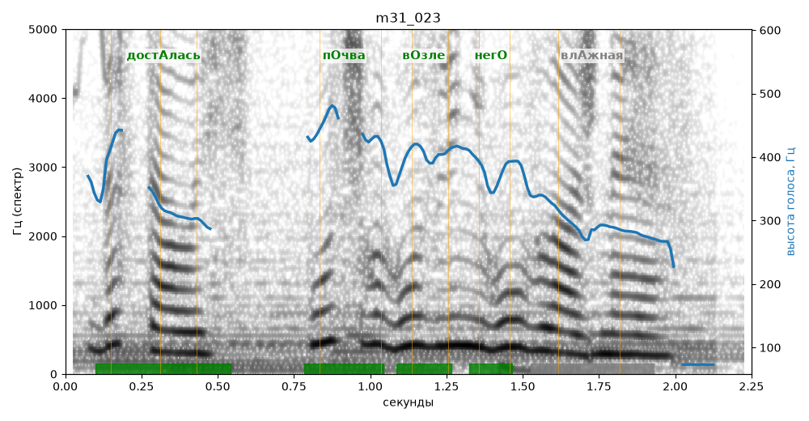

# m31_023

Голос: **Пик (серия 31, 74.5 с)** · длительность 2.2 с
Естественность (UTMOS): **1.37 из 5** (живой диктор ≈ 4–4.5)
Эталон: Досталась. Почва возле него влажная.
Распознано: Досталось пучрого злинего увлажнения.
Расхождения в словах: «досталась почва возле него влажная» → «досталось пучрого злинего увлажнения»

## Ударения
(где нужно: ruaccent)

| слово | нужно | у голоса | |
|---|---|---|---|
| досталась | достАлась | достАлась | ✓ |
| почва | пОчва | пОчва | ✓ |
| возле | вОзле | вОзле | ✓ |
| него | негО | негО | ✓ |
| влажная | влАжная | — | ? |

## Интонация
- ✗ «досталась.» — конец фразы не понижается — звучит незаконченно / как перечисление
- ✓ «почва возле него влажная.» — конец фразы понижается — звучит законченно
- Диапазон голоса 31.1 полутонов (живо), средняя высота 340 Гц

## Паузы и темп
- паузы на своих местах
- Темп 6.9 слога/с (быстро)

_Синяя линия — высота голоса. Над словами заглавная буква — где ударение должно быть; красным — голос поставил не туда (уверенно), оранжевым — возможно._
