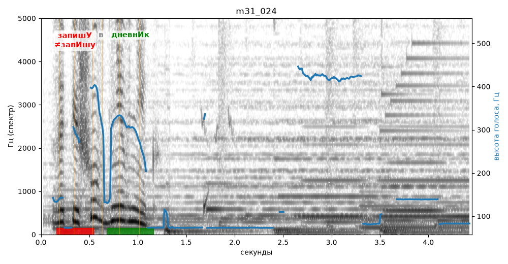

# m31_024

Голос: **Филя (серия 31, 76.9 с)** · длительность 4.4 с
Естественность (UTMOS): **1.3 из 5** (живой диктор ≈ 4–4.5)
Эталон: Запишу в дневник.
Распознано: Запишу в дневник.
Слова: все совпали

## Ударения
(где нужно: ruaccent)

| слово | нужно | у голоса | |
|---|---|---|---|
| запишу | запишУ | запИшу | ✗ ОШИБКА |
| дневник | дневнИк | дневнИк | ✓ |

## Интонация
- ✗ «запишу в дневник.» — конец фразы не понижается — звучит незаконченно / как перечисление
- Диапазон голоса 30.5 полутонов (живо), средняя высота 111 Гц

## Паузы и темп
- паузы на своих местах
- Темп 6.0 слога/с (нормально)

_Синяя линия — высота голоса. Над словами заглавная буква — где ударение должно быть; красным — голос поставил не туда (уверенно), оранжевым — возможно._
