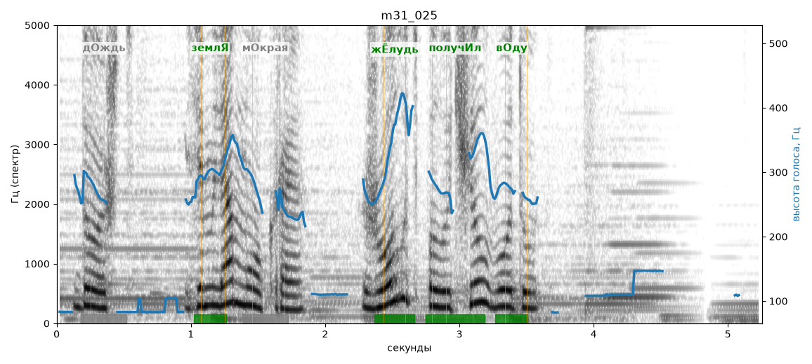

# m31_025

Голос: **Филя (серия 31, 81.5 с)** · длительность 5.3 с
Естественность (UTMOS): **1.98 из 5** (живой диктор ≈ 4–4.5)
Эталон: Дождь. Земля мокрая. Жёлудь получил воду
Распознано: Дождь, земля мокрая, желуть получил воду.
Расхождения в словах: «желудь» → «желуть»

## Ударения
(где нужно: ruaccent)

| слово | нужно | у голоса | |
|---|---|---|---|
| земля | землЯ | землЯ | ✓ |
| мокрая | мОкрая | — | ? |
| жёлудь | жЁлудь | жЁлудь | ✓ |
| получил | получИл | получИл | ✓ |
| воду | вОду | вОду | ✓ |

## Интонация
- ✗ «земля мокрая.» — конец фразы не понижается — звучит незаконченно / как перечисление
- ✗ «жёлудь получил воду» — конец фразы не понижается — звучит незаконченно / как перечисление
- Диапазон голоса 25.3 полутонов (живо), средняя высота 251 Гц

## Паузы и темп
- паузы на своих местах
- Темп 5.5 слога/с (нормально)

_Синяя линия — высота голоса. Над словами заглавная буква — где ударение должно быть; красным — голос поставил не туда (уверенно), оранжевым — возможно._
