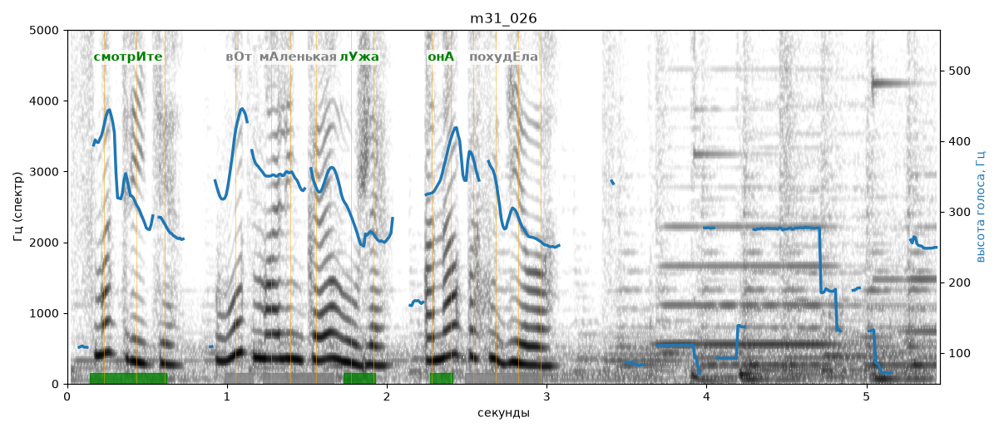

# m31_026

Голос: **Рон (серия 31, 86.9 с)** · длительность 5.5 с
Естественность (UTMOS): **1.43 из 5** (живой диктор ≈ 4–4.5)
Эталон: Смотрите! Вот маленькая лужа! Она похудела!
Распознано: Смотрите, вот маленькая лужа, она похудела.
Слова: все совпали

## Ударения
(где нужно: ruaccent)

| слово | нужно | у голоса | |
|---|---|---|---|
| смотрите | смотрИте | смотрИте | ✓ |
| маленькая | мАленькая | — | ? |
| лужа | лУжа | лУжа | ✓ |
| она | онА | онА | ✓ |
| похудела | похудЕла | похуделА | ? не разобрать |

## Интонация
- ✗ «смотрите!» — восклицание звучит ровно, без эмоции
- ✗ «вот маленькая лужа!» — восклицание звучит ровно, без эмоции
- ✓ «она похудела!» — выделено слово «она» (+3.4 пт)
- Диапазон голоса 26.9 полутонов (живо), средняя высота 276 Гц

## Паузы и темп
- паузы на своих местах
- Темп 7.0 слога/с (быстро)

_Синяя линия — высота голоса. Над словами заглавная буква — где ударение должно быть; красным — голос поставил не туда (уверенно), оранжевым — возможно._
