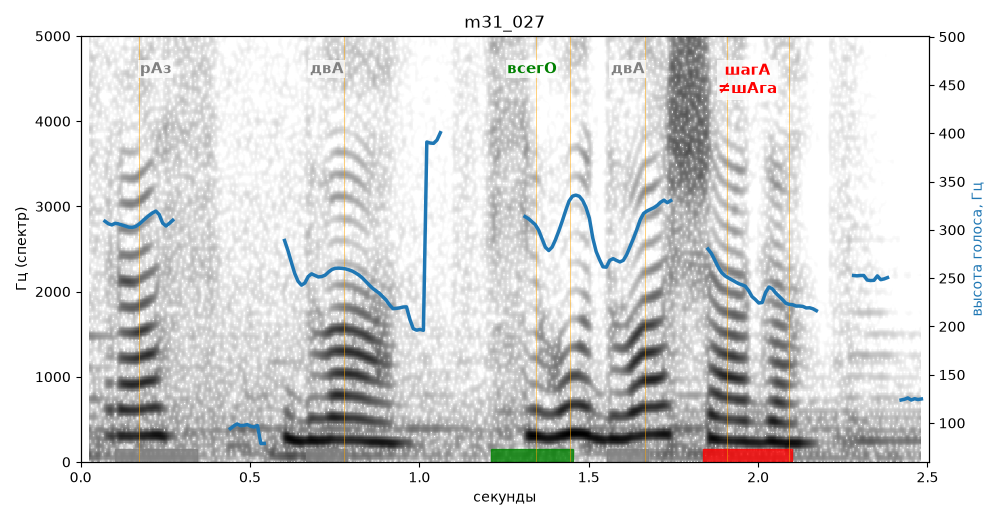

# m31_027

Голос: **Рон (серия 31, 92.4 с)** · длительность 2.5 с
Естественность (UTMOS): **2.04 из 5** (живой диктор ≈ 4–4.5)
Эталон: Раз, два! Всего два шага!
Распознано: Раз, два, всего два шага.
Слова: все совпали

## Ударения
(где нужно: ruaccent)

| слово | нужно | у голоса | |
|---|---|---|---|
| всего | всегО | всегО | ✓ |
| шага | шагА | шАга | ✗ ОШИБКА |

## Интонация
- ✗ «всего два шага!» — восклицание звучит ровно, без эмоции
- Диапазон голоса 21.2 полутонов (живо), средняя высота 255 Гц

## Паузы и темп
- паузы на своих местах
- Темп 6.4 слога/с (нормально)

_Синяя линия — высота голоса. Над словами заглавная буква — где ударение должно быть; красным — голос поставил не туда (уверенно), оранжевым — возможно._
