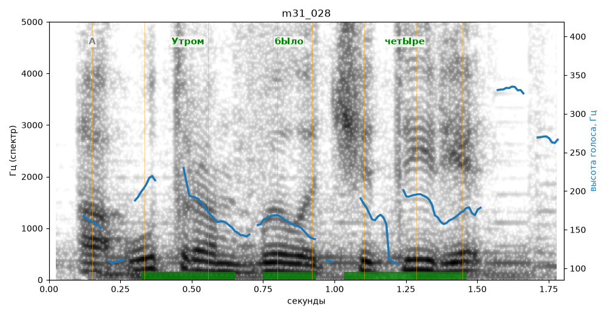

# m31_028

Голос: **Топа (серия 31, 95.1 с)** · длительность 1.8 с
Естественность (UTMOS): **2.5 из 5** (живой диктор ≈ 4–4.5)
Эталон: А утром было четыре!
Распознано: А утром было четыре...
Слова: все совпали

## Ударения
(где нужно: ruaccent)

| слово | нужно | у голоса | |
|---|---|---|---|
| утром | Утром | Утром | ✓ |
| было | бЫло | бЫло | ✓ |
| четыре | четЫре | четЫре | ✓ |

## Интонация
- ✓ «а утром было четыре!» — выделено слово «утром» (+3.2 пт)
- Диапазон голоса 19.2 полутонов (живо), средняя высота 168 Гц

## Паузы и темп
- паузы на своих местах
- Темп 6.9 слога/с (быстро)

_Синяя линия — высота голоса. Над словами заглавная буква — где ударение должно быть; красным — голос поставил не туда (уверенно), оранжевым — возможно._
