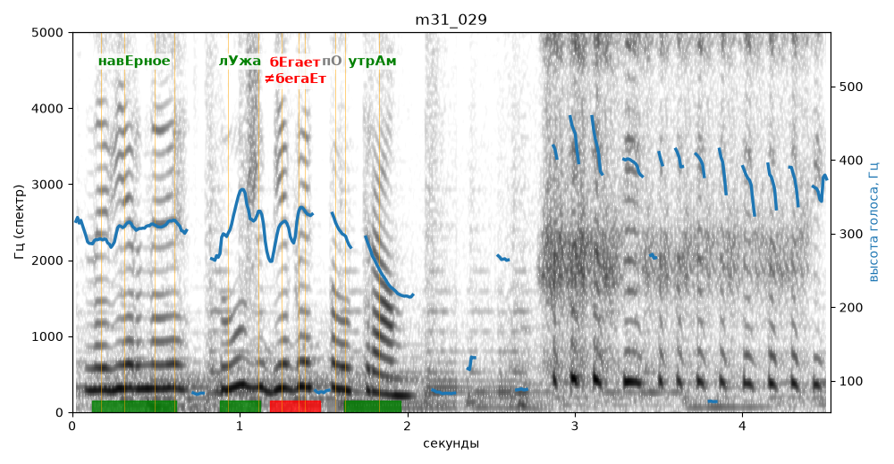

# m31_029

Голос: **Рон (серия 31, 97.0 с)** · длительность 4.5 с
Естественность (UTMOS): **1.27 из 5** (живой диктор ≈ 4–4.5)
Эталон: Наверное, лужа бегает по утрам.
Распознано: Наверное, дуж бегает по утрам.
Расхождения в словах: «лужа» → «дуж»

## Ударения
(где нужно: ruaccent)

| слово | нужно | у голоса | |
|---|---|---|---|
| наверное | навЕрное | навЕрное | ✓ |
| лужа | лУжа | лУжа | ✓ |
| бегает | бЕгает | бегаЕт | ✗ ОШИБКА |
| утрам | утрАм | утрАм | ✓ |

## Интонация
- ✓ «наверное лужа бегает по утрам.» — конец фразы понижается — звучит законченно
- Диапазон голоса 27.5 полутонов (живо), средняя высота 308 Гц

## Паузы и темп
- паузы на своих местах
- Темп 7.6 слога/с (быстро)

_Синяя линия — высота голоса. Над словами заглавная буква — где ударение должно быть; красным — голос поставил не туда (уверенно), оранжевым — возможно._
