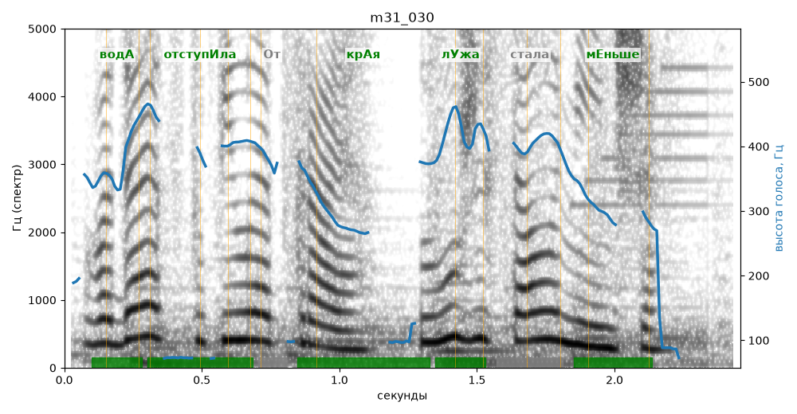

# m31_030

Голос: **Пик (серия 31, 101.6 с)** · длительность 2.5 с
Естественность (UTMOS): **1.33 из 5** (живой диктор ≈ 4–4.5)
Эталон: Вода отступила от края. Лужа стала меньше.
Распознано: Вода отступила от края, и уже стало меньше.
Расхождения в словах: «лужа стала» → «и уже стало»

## Ударения
(где нужно: ruaccent)

| слово | нужно | у голоса | |
|---|---|---|---|
| вода | водА | водА | ✓ |
| отступила | отступИла | отступИла | ✓ |
| края | крАя | крАя | ✓ |
| лужа | лУжа | лУжа | ✓ |
| стала | стала | стАла | нет эталона |
| меньше | мЕньше | мЕньше | ✓ |

## Интонация
- ✓ «вода отступила от края.» — конец фразы понижается — звучит законченно
- ✓ «лужа стала меньше.» — конец фразы понижается — звучит законченно
- Диапазон голоса 31.4 полутонов (живо), средняя высота 355 Гц

## Паузы и темп
- после «края.» пауза всего 0.02 с — фразы слипаются
- Темп 6.9 слога/с (быстро)

_Синяя линия — высота голоса. Над словами заглавная буква — где ударение должно быть; красным — голос поставил не туда (уверенно), оранжевым — возможно._
