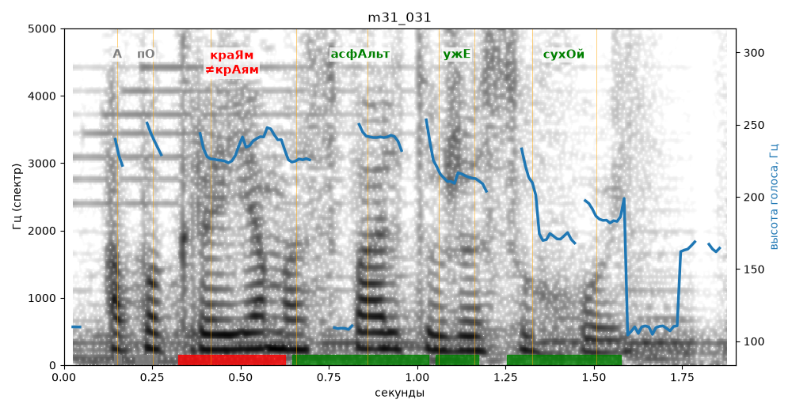

# m31_031

Голос: **Барсик (серия 31, 104.2 с)** · длительность 1.9 с
Естественность (UTMOS): **2.67 из 5** (живой диктор ≈ 4–4.5)
Эталон: А по краям асфальт уже сухой.
Распознано: А по краям асфальт уже сухой.
Слова: все совпали

## Ударения
(где нужно: ruaccent)

| слово | нужно | у голоса | |
|---|---|---|---|
| краям | краЯм | крАям | ✗ ОШИБКА |
| асфальт | асфАльт | асфАльт | ✓ |
| уже | ужЕ | ужЕ | ✓ |
| сухой | сухОй | сухОй | ✓ |

## Интонация
- ✓ «а по краям асфальт уже сухой.» — конец фразы понижается — звучит законченно
- Диапазон голоса 14.0 полутонов (живо), средняя высота 213 Гц

## Паузы и темп
- паузы на своих местах
- Темп 6.3 слога/с (нормально)

_Синяя линия — высота голоса. Над словами заглавная буква — где ударение должно быть; красным — голос поставил не туда (уверенно), оранжевым — возможно._
