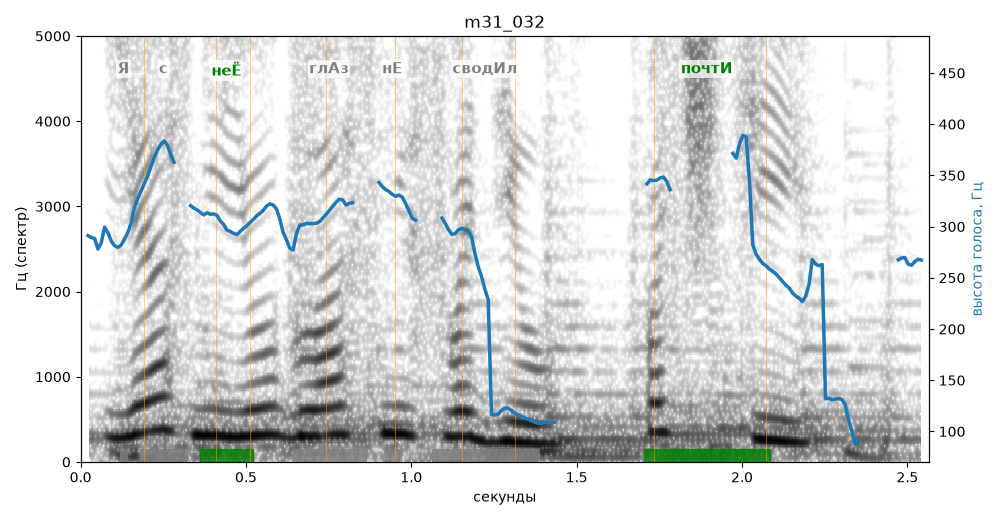

# m31_032

Голос: **Рон (серия 31, 106.2 с)** · длительность 2.6 с
Естественность (UTMOS): **1.62 из 5** (живой диктор ≈ 4–4.5)
Эталон: Я с неё глаз не сводил. Почти.
Распознано: Я с неё глаз не сводил, почти.
Слова: все совпали

## Ударения
(где нужно: ruaccent)

| слово | нужно | у голоса | |
|---|---|---|---|
| неё | неЁ | неЁ | ✓ |
| сводил | сводИл | свОдил | ? не разобрать |
| почти | почтИ | почтИ | ✓ |

## Интонация
- ✓ «я с неё глаз не сводил.» — конец фразы понижается — звучит законченно
- Диапазон голоса 21.0 полутонов (живо), средняя высота 295 Гц

## Паузы и темп
- паузы на своих местах
- Темп 5.5 слога/с (нормально)

_Синяя линия — высота голоса. Над словами заглавная буква — где ударение должно быть; красным — голос поставил не туда (уверенно), оранжевым — возможно._
