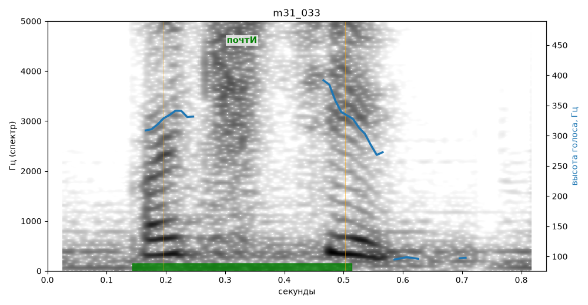

# m31_033

Голос: **Филя (серия 31, 108.9 с)** · длительность 0.8 с
Естественность (UTMOS): **2.37 из 5** (живой диктор ≈ 4–4.5)
Эталон: Почти?
Распознано: Почти.
Слова: все совпали

## Ударения
(где нужно: ruaccent)

| слово | нужно | у голоса | |
|---|---|---|---|
| почти | почтИ | почтИ | ✓ |

## Интонация
- Диапазон голоса 23.6 полутонов (живо), средняя высота 313 Гц

## Паузы и темп
- паузы на своих местах
- Темп 5.4 слога/с (нормально)

_Синяя линия — высота голоса. Над словами заглавная буква — где ударение должно быть; красным — голос поставил не туда (уверенно), оранжевым — возможно._
