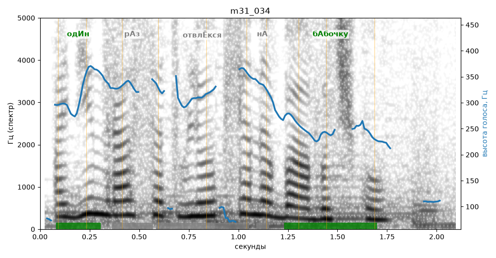

# m31_034

Голос: **Рон (серия 31, 109.9 с)** · длительность 2.1 с
Естественность (UTMOS): **1.6 из 5** (живой диктор ≈ 4–4.5)
Эталон: Один раз отвлёкся на бабочку.
Распознано: Один раз отвлёкся на бабочку.
Слова: все совпали

## Ударения
(где нужно: ruaccent)

| слово | нужно | у голоса | |
|---|---|---|---|
| один | одИн | одИн | ✓ |
| отвлёкся | отвлЁкся | отвлёксЯ | ? не разобрать |
| бабочку | бАбочку | бАбочку | ✓ |

## Интонация
- ✓ «один раз отвлёкся на бабочку.» — конец фразы понижается — звучит законченно
- Диапазон голоса 26.0 полутонов (живо), средняя высота 293 Гц

## Паузы и темп
- паузы на своих местах
- Темп 6.2 слога/с (нормально)

_Синяя линия — высота голоса. Над словами заглавная буква — где ударение должно быть; красным — голос поставил не туда (уверенно), оранжевым — возможно._
