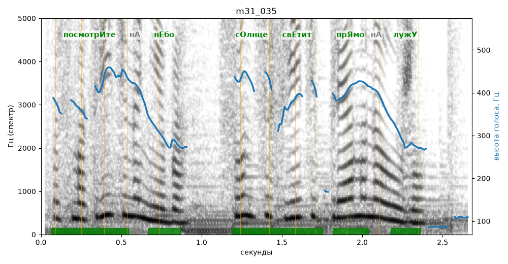

# m31_035

Голос: **Пик (серия 31, 112.1 с)** · длительность 2.7 с
Естественность (UTMOS): **1.27 из 5** (живой диктор ≈ 4–4.5)
Эталон: Посмотрите на небо. Солнце светит прямо на лужу.
Распознано: Посмотрите на небо! Солнце светит прямо на ужин!
Расхождения в словах: «лужу» → «ужин»

## Ударения
(где нужно: ruaccent)

| слово | нужно | у голоса | |
|---|---|---|---|
| посмотрите | посмотрИте | посмотрИте | ✓ |
| небо | нЕбо | нЕбо | ✓ |
| солнце | сОлнце | сОлнце | ✓ |
| светит | свЕтит | свЕтит | ✓ |
| прямо | прЯмо | прЯмо | ✓ |
| лужу | лужУ | лужУ | ✓ |

## Интонация
- ✓ «посмотрите на небо.» — конец фразы понижается — звучит законченно
- ✓ «солнце светит прямо на лужу.» — конец фразы понижается — звучит законченно
- Диапазон голоса 28.3 полутонов (живо), средняя высота 376 Гц

## Паузы и темп
- паузы на своих местах
- Темп 8.1 слога/с (быстро)

_Синяя линия — высота голоса. Над словами заглавная буква — где ударение должно быть; красным — голос поставил не туда (уверенно), оранжевым — возможно._
