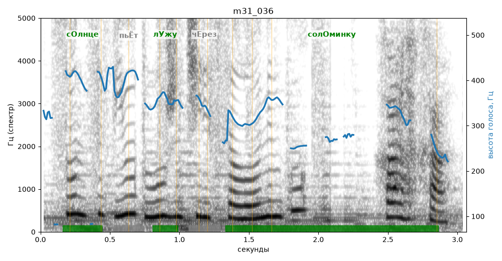

# m31_036

Голос: **Рон (серия 31, 114.9 с)** · длительность 3.1 с
Естественность (UTMOS): **1.33 из 5** (живой диктор ≈ 4–4.5)
Эталон: Солнце пьёт лужу через соломинку?
Распознано: Солнце пьют лужи через соломинку? Хаха!
Расхождения в словах: «пьет лужу» → «пьют лужи»; «» → «хаха»

## Ударения
(где нужно: ruaccent)

| слово | нужно | у голоса | |
|---|---|---|---|
| солнце | сОлнце | сОлнце | ✓ |
| лужу | лУжу | лУжу | ✓ |
| через | чЕрез | черЕз | ? не разобрать |
| соломинку | солОминку | солОминку | ✓ |

## Интонация
- ✗ «солнце пьёт лужу через соломинку?» — нет вопросительного подъёма (самое высокое место — «солнце», в начале) — звучит как утверждение
- Диапазон голоса 10.3 полутонов (живо), средняя высота 338 Гц

## Паузы и темп
- паузы на своих местах
- Темп 4.1 слога/с (нормально)

_Синяя линия — высота голоса. Над словами заглавная буква — где ударение должно быть; красным — голос поставил не туда (уверенно), оранжевым — возможно._
