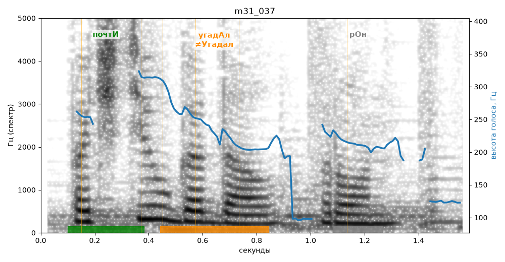

# m31_037

Голос: **Барсик (серия 31, 118.1 с)** · длительность 1.6 с
Естественность (UTMOS): **2.59 из 5** (живой диктор ≈ 4–4.5)
Эталон: Почти угадал, Рон.
Распознано: Почти угадал Рон.
Слова: все совпали

## Ударения
(где нужно: ruaccent)

| слово | нужно | у голоса | |
|---|---|---|---|
| почти | почтИ | почтИ | ✓ |
| угадал | угадАл | Угадал | ✗? возможно — послушать |

## Интонация
- ✓ «почти угадал рон.» — конец фразы понижается — звучит законченно
- Диапазон голоса 20.1 полутонов (живо), средняя высота 214 Гц

## Паузы и темп
- паузы на своих местах
- Темп 6.5 слога/с (нормально)

_Синяя линия — высота голоса. Над словами заглавная буква — где ударение должно быть; красным — голос поставил не туда (уверенно), оранжевым — возможно._
